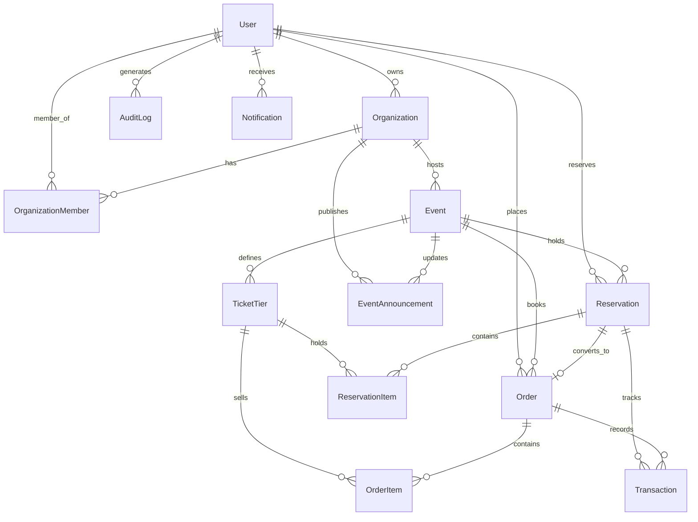

# EventSphere – Multi-Tenant Event & Ticket Reservation System

EventSphere is a production-grade, multi-tenant event discovery and ticketing platform built with **React, Node.js, Express, TypeScript, and Tailwind CSS**. It features a concurrency-safe **10-minute hold reservation engine**, simulated **mock payment gateway**, strict **tenant isolation**, and real-time **organizer analytics**.

---

## 1. High-Level Architecture & Tech Stack

```
[ Clients / Browsers ]
       │
       ▼
[ Vite React SPA (Port 3000) ]
       │
       ▼ (REST API / JWT Auth)
[ Express.js Fullstack Server (Node.js + TS) ]
 ├── [ Authentication & RBAC Middleware ]
 ├── [ Multi-Tenant Isolation Middleware (Organization Scoping) ]
 ├── [ Redis Caching Layer (TTL & Invalidation) ]
 ├── [ Concurrency-Safe 10-Min Hold Engine (Atomic Row Locking) ]
 ├── [ Mock Payment Gateway Simulation (Success/Failure/Timeout) ]
 └── [ Background Worker (Scheduled Cleanup & Expiration) ]
       │
       ▼
[ PostgreSQL / Prisma ORM Persistence ]
```

### Technologies Used
- **Frontend:** React 19, TypeScript, Vite, Tailwind CSS v4, React Router v7, Recharts, Lucide React, Axios, Canvas Confetti.
- **Backend:** Node.js, Express 4, TypeScript (tsx), JWT Authentication, Bcrypt password hashing.
- **Database & Storage:** PostgreSQL schema DDL, Prisma Schema (`prisma/schema.prisma`), persistent ACID transactional store with row-level mutex locking.
- **Caching & Queue:** Redis caching simulation service (`cacheService.ts`), background reservation expiration worker (`reservationWorker.ts`), Docker Compose for Redis 7 + PostgreSQL 16.

---

## 2. Entity-Relationship (ER) Diagram



### Major Entities & Fields
1. **User:** `id, name, email, passwordHash, role (ADMIN | ORGANIZER | ATTENDEE), status (ACTIVE | SUSPENDED), createdAt, updatedAt`
2. **Organization (Tenant):** `id, name, slug, ownerId, status (ACTIVE | SUSPENDED), description, logoUrl, createdAt`
3. **OrganizationMember:** `id, organizationId, userId, role (OWNER | ADMIN | MEMBER), createdAt`
4. **Event:** `id, organizationId, title, description, bannerUrl, category, venue, address, eventDate, startTime, endTime, salesStartAt, salesCutoffAt, capacity, status, createdAt`
5. **TicketTier:** `id, eventId, name, price, totalQuantity, availableQuantity, reservedQuantity, soldQuantity, createdAt`
6. **Reservation:** `id, userId, eventId, status (PENDING | CONFIRMED | EXPIRED | CANCELLED | PAYMENT_FAILED), expiresAt, idempotencyKey, totalAmount, createdAt`
7. **ReservationItem:** `id, reservationId, ticketTierId, quantity, unitPrice`
8. **Order:** `id, userId, eventId, reservationId, bookingReference, attendeeName, attendeeEmail, attendeePhone, totalAmount, status, createdAt`
9. **OrderItem:** `id, orderId, ticketTierId, quantity, unitPrice`
10. **Transaction:** `id, orderId, reservationId, paymentReference, amount, paymentMethod, status, idempotencyKey, createdAt`
11. **EventAnnouncement:** `id, eventId, organizationId, title, content, isPinned, createdAt`
12. **AuditLog:** `id, userId, action, resourceType, resourceId, details, createdAt`

---

## 3. Concurrency & Double-Booking Prevention

### The Problem
During high-demand ticket drops, dozens of users click "Reserve" simultaneously on the last remaining tickets. Naive read-then-write logic causes race conditions, negative inventory, and double-booking.

### The Solution: 10-Minute Atomic Hold
1. **Row-Level Transaction Locking:**
   When an attendee requests tickets:
   ```sql
   BEGIN;
   SELECT * FROM ticket_tiers WHERE id = ? FOR UPDATE;
   -- Check if available_quantity >= requested
   -- If not: ROLLBACK and throw INSUFFICIENT_INVENTORY (HTTP 409)
   UPDATE ticket_tiers SET available_quantity = available_quantity - ?, reserved_quantity = reserved_quantity + ?;
   INSERT INTO reservations (expires_at = NOW() + INTERVAL '10 minutes', ...);
   COMMIT;
   ```
2. **Deterministic Expiration Worker:**
   - Runs every 5 seconds to reconcile expired holds.
   - If a hold reaches its expiration timestamp without a confirmed order, the worker atomically executes:
     `available_quantity += quantity; reserved_quantity -= quantity; status = 'EXPIRED'`.
3. **Failure Rollback:**
   - If payment is declined or fails, the held inventory is immediately restored.
4. **Idempotency Keys:**
   - Both reservations and payments accept client-generated `idempotencyKey` values. Duplicate network requests or retries return the existing session rather than double-holding inventory.

---

## 4. Default Seed Accounts for Evaluators

| Role | Email | Password | Organization Tenant |
|---|---|---|---|
| **Platform Admin** | `admin@eventsphere.com` | `Admin@123` | Platform Global Access |
| **Organizer 1** | `sarah@pulseevents.com` | `Organizer@123` | Pulse Media & Events |
| **Organizer 2** | `david@horizonlive.com` | `Organizer@123` | Horizon Live Experiences |
| **Attendee** | `attendee@example.com` | `Attendee@123` | Individual Attendee |

*(Note: You can also use the **Instant 1-Click Demo Login** bar at the top of the navbar to switch personas instantly.)*

---

## 5. API Endpoints

### Authentication
- `POST /api/auth/register` - Create Attendee or Organizer account
- `POST /api/auth/login` - Authenticate and receive JWT token
- `GET /api/auth/me` - Current authenticated user & organization
- `POST /api/auth/logout` - Invalidate session

### Events & Discovery (Redis Cached)
- `GET /api/events` - Public event catalog with category, search, and date filters
- `GET /api/events/:id` - Detailed event information, ticket tiers, and capacity stats

### Concurrency-Safe Reservations
- `POST /api/reservations` - Atomic 10-minute inventory hold
- `GET /api/reservations/:id` - Status & live server-synced countdown
- `POST /api/reservations/:id/cancel` - Cancel hold and release tickets

### Mock Payment Gateway
- `POST /api/payments/initiate` - Create payment intent
- `GET /api/payments/:id/status` - Check status
- `POST /api/payments/process` - Simulate payment (SUCCESS, FAILURE, TIMEOUT modes)
- `POST /api/payments/webhook` - Asynchronous callback handler

### Orders & Digital Passes
- `GET /api/orders` - Attendee's confirmed bookings
- `GET /api/orders/:id` - Detailed pass with QR code
- `POST /api/orders/:id/cancel` - Cancel order & restore inventory

### Organizer Portal (Tenant Isolated)
- `GET /api/organizer/events` - Scoped event inventory
- `POST /api/organizer/events` - Create event (with capacity check)
- `PUT /api/organizer/events/:id` - Update event
- `DELETE /api/organizer/events/:id` - Delete event (blocked if tickets sold)
- `PATCH /api/organizer/events/:id/publish` - Toggle publish/draft
- `POST /api/organizer/events/:eventId/tickets` - Add ticket tier
- `GET /api/organizer/bookings` - Attendee orders list
- `GET /api/organizer/export/bookings` - Export bookings CSV
- `GET /api/organizer/analytics/overview` - Scoped KPIs, revenue, funnel

### Admin Governance
- `GET /api/admin/stats` - Platform-wide analytics
- `GET /api/admin/users` - View all users
- `PATCH /api/admin/users/:id/status` - Suspend/reactivate user
- `GET /api/admin/organizations` - View all tenants
- `PATCH /api/admin/organizations/:id/status` - Moderate tenant status
- `GET /api/admin/events` - Moderate platform events
- `PATCH /api/admin/events/:id/status` - Approve/suspend event
- `GET /api/admin/transactions` - Monitor transactions & idempotency keys
- `POST /api/admin/reseed` - Reset database to initial seeds

---

## 6. Testing & Concurrency Validation

### 1. Automated Concurrency Test Script
To run the automated 20-concurrent request contention test (20 users competing simultaneously for 10 tickets):
```bash
npm run test:concurrency
```
**Expected Output:**
```
✓ Initial state: 10 tickets available, 0 reserved, 0 sold.
⚡ Firing 20 simultaneous reservation requests...
--- Test Execution Results ---
Total Requests: 20
Successes:     10 (Expected: 10)
Failures:      10 (Expected: 10)
Available Qty: 0 (Expected: 0)
Reserved Qty:  10 (Expected: 10)
Sold Qty:      0 (Expected: 0)
✅ CONCURRENCY TEST PASSED: No double-booking occurred!
```

### 2. Live UI Concurrency Benchmark
Click the **"Test Concurrency"** button in the top navigation bar to execute the 20-thread benchmark in real-time from the browser and inspect the assertions visually.

### 3. Postman Collection
Import `EventSphere.postman_collection.json` into Postman. It contains pre-configured requests, environment variables (`baseUrl`, `adminToken`, `organizerToken`, `attendeeToken`), and automated test assertions.

---

## 7. Local & Container Setup Instructions

### Option A: Local Node.js
```bash
# 1. Install dependencies
npm install

# 2. Start fullstack development server (Express + Vite)
npm run dev

# 3. Access in browser
http://localhost:3000
```

### Option B: Docker Compose (PostgreSQL 16 + Redis 7 + App + Worker)
```bash
docker-compose up --build
```

---

## 8. Deployment Configurations

### Deploy to Render or Railway
1. Set Environment Variables:
   - `NODE_ENV=production`
   - `PORT=3000`
   - `DATABASE_URL=postgresql://...`
   - `JWT_SECRET=your-production-secret-key`
2. Build Command: `npm run build`
3. Start Command: `npm start` (runs `tsx server/server.ts`)

### Deploy Frontend to Vercel
1. Set root directory or configure proxy in `vercel.json` pointing `/api/(.*)` to the deployed backend service.
